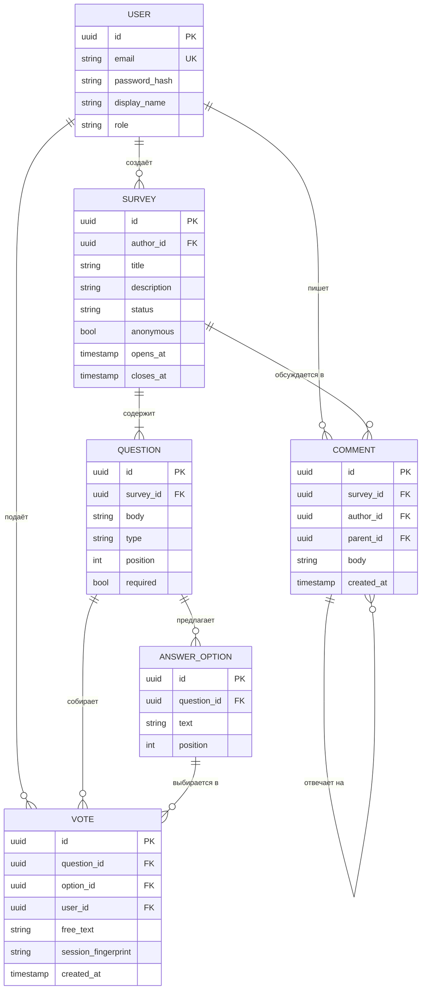

# Сервис проведения опросов

Платформа, где пользователи могут создавать опросы с разными типами вопросов, делиться ими и анализировать полученные ответы.

## Идея

Разработчики используют данный сервис в составе своей микросервисной архитектуры.

Он позволяет:
- создавать опрос от 1 до N вопросов,
- редактировать опрос,
- получать голоса анонимно и персонализированно,
- комментировать опрос,
- получить вопросы опроса с пагинацией,
- удалять голоса из опроса.

### Для кого

| Роль | Что получает |
|---|---|
| Backend-разработчик | Готовый микросервис опросов, который подключается к своей системе по REST API вместо написания собственной логики |
| Автор опроса | Конструктор вопросов, ссылка для распространения, агрегированная статистика по ответам |
| Респондент | Возможность проголосовать анонимно или под своей учётной записью, оставить комментарий, отозвать свой голос |

## Сущности

| Сущность | Назначение | Ключевые поля | Связи |
|---|---|---|---|
| User | Пользователь сервиса: автор опросов и/или респондент | идентификатор, почта, хеш пароля, отображаемое имя, роль | владеет опросами, голосами и комментариями |
| Survey | Опрос как единица публикации: заголовок, режим доступа, срок жизни | идентификатор, автор, название, описание, статус (черновик/опубликован/закрыт), режим анонимности, дата открытия, дата закрытия | принадлежит пользователю, содержит много вопросов и комментариев |
| Question | Отдельный вопрос внутри опроса с указанием типа | идентификатор, опрос, формулировка, тип (одиночный выбор/множественный/шкала/свободный текст), порядковый номер, признак обязательности | принадлежит опросу, содержит много вариантов ответа и голосов |
| AnswerOption | Готовый вариант ответа для вопросов с выбором | идентификатор, вопрос, текст варианта, порядковый номер | принадлежит вопросу, на него ссылаются голоса |
| Vote | Голос респондента по конкретному вопросу | идентификатор, вопрос, выбранный вариант, автор (может быть пустым для анонимного), текстовый ответ, отпечаток сессии, дата подачи | принадлежит вопросу и варианту ответа, опционально пользователю |
| Comment | Обсуждение опроса участниками | идентификатор, опрос, автор, текст, дата создания, родительский комментарий | принадлежит опросу и пользователю, может отвечать другому комментарию |

### ER-диаграмма



**Конкурентный ресурс:** право голоса - единственная запись `Vote` для пары «вопрос + респондент» (респондент определяется идентификатором пользователя, а для анонимного режима - отпечатком сессии).

**Правило разрешения конкуренции:** на пару `(question_id, voter_key)` наложено уникальное ограничение в базе, а подача голоса выполняется одной транзакцией. При одновременных запросах фиксируется тот, чья транзакция закоммитилась первой; остальные получают `409 Conflict` и подсказку, что голос уже учтён. Изменить свой выбор можно только через явное удаление голоса и повторную подачу, а после наступления `closes_at` или перехода опроса в статус «закрыт» запись новых голосов отклоняется независимо от того, кто успел раньше.

## Структура проекта

```text
survey-service/
  pyproject.toml
  uv.lock
  .python-version
  .gitignore
  README.md
  docs/
    lab-01-report.md
  rawhttp/
    __init__.py
    server.py
```

Пакет `rawhttp` - HTTP-сервер поверх сокетов, написанный средствами стандартной
библиотеки. Файл `server.py` содержит последовательную однопоточную реализацию:
соединения принимаются по очереди и обслуживаются одно за раз.

Внешних зависимостей у проекта нет. В группе разработки находится только линтер
`ruff`, его конфигурация лежит в `pyproject.toml`.

## Запуск

Нужен [uv](https://docs.astral.sh/uv/). Python 3.13 зафиксирован в `.python-version`
и `pyproject.toml`, `uv` поставит его сам, если в системе такой версии нет.

```bash
git clone git@git.digital.mephi.ru:hachen/survey-service.git
cd survey-service
uv sync
uv run python -m rawhttp.server
```

Сервер слушает `127.0.0.1:8000`. Адрес и порт задаются аргументами:

```bash
uv run python -m rawhttp.server --host 127.0.0.1 --port 9000
```

Проверка в соседнем терминале:

```bash
curl -i http://127.0.0.1:8000/health
```

### Маршруты

| Метод | Путь | Смысл | Успех | Ошибки |
|---|---|---|---|---|
| GET | `/health` | состояние сервиса, его имя и версия | 200 | 405 |
| POST | `/surveys` | создать опрос из тела JSON | 201 | 400, 405 |
| DELETE | `/surveys/{id}` | удалить опрос по идентификатору | 204 | 404, 405 |

Опросы хранятся в словаре в памяти и исчезают при перезапуске сервера.

### Проверка всех случаев

```bash
curl -i http://127.0.0.1:8000/health
curl -i -X POST http://127.0.0.1:8000/surveys -H 'Content-Type: application/json' \
  -d '{"title": "Кофе или чай", "status": "draft"}'
curl -i -X DELETE http://127.0.0.1:8000/surveys/1
curl -i -X PUT http://127.0.0.1:8000/health
curl -i http://127.0.0.1:8000/nothing-here
curl -i -X POST http://127.0.0.1:8000/surveys -H 'Content-Type: application/json' \
  -d '{"title": 1,'
curl -i -X DELETE http://127.0.0.1:8000/surveys/999
curl -i -X POST http://127.0.0.1:9000/surveys -H 'Content-Type: application/json' \
  -d '{"title": "Встреча с заказчиком", "status": "draft"}'
```

Ожидаемые коды по порядку: 200, 201, 204, 405, 404, 400, 404, 201.

Проверка кода линтером:

```bash
uv run ruff check .
uv run ruff format --check .
```

## Отчёт

Результаты проверок и разбор обменов - в `docs/lab-01-report.md`.
